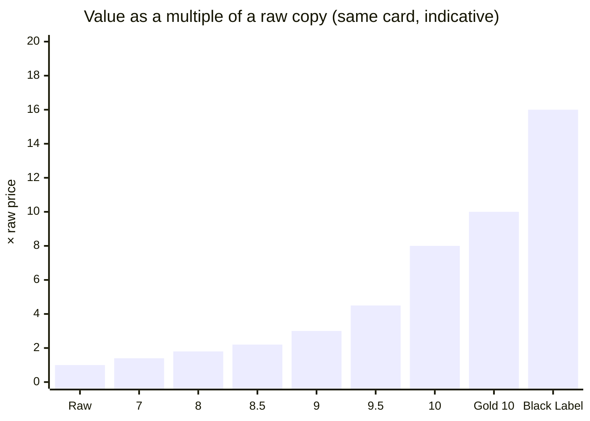

# Grade value tiers

How a card's grader, numeric grade and label change its value, for the **same card** (same name, set, print). Ordered highest value first. The top of the ladder is a **BGS Black Label 10**; the bottom is a raw, ungraded copy.

> The multipliers below are **indicative** — a rough "how many times a raw copy" figure for modern chase cards (Pokémon / One Piece). Real premiums swing hard with the specific card, its population at each grade, and demand. Treat the ranking as firm and the numbers as a feel, not a quote.

## The ladder

| Rank | Tier | Grader(s) | What it is | Value vs raw (indicative) |
|-----:|------|-----------|------------|:-------------------------:|
| 1 | **Black Label 10** | BGS | Pristine 10 where **all four sub-grades are a perfect 10** — the rarest slab BGS awards, biggest premium in the hobby | **~10–25×+** |
| 2 | **Gold Label 10** (Pristine 10) | BGS | A BGS 10 that is *not* all-10 sub-grades. A true BGS 10 is very rare, so it leads the regular 10s on scarcity | ~6–14× |
| 3 | **Gem Mint 10** | PSA | PSA's top grade — the **resale benchmark** for Pokémon, most traded and most liquid 10 | ~5–12× |
| 4 | **Pristine 10** | CGC | CGC's top grade; usually sells a little under a PSA 10 of the same card | ~5–10× |
| 5 | **Gem Mint 9.5** | BGS, CGC | Half a step below a 10 (PSA gives no half grades); still a strong premium | ~3–6× |
| 6 | **Mint 9** | PSA, BGS, CGC | A clean, well-kept slab | ~2–4× |
| 7 | **8.5** | BGS, CGC | Near Mint–Mint with a visible flaw | ~1.8–2.5× |
| 8 | **8** | PSA, BGS, CGC | Near Mint–Mint | ~1.5–2× |
| 9 | **7** | PSA, BGS, CGC | Near Mint | ~1.2–1.5× |
| 10 | **Raw / ungraded** | — | No slab, no grade — the baseline | 1× |

Ranks 2–4 are the **regular 10s, and the order is genuinely debated** — hobby sources disagree. This project ranks them by **scarcity** (a true BGS 10 is far rarer than a PSA 10), so Gold Label leads. By **realized resale price** the order often flips: a **PSA 10** is the most liquid and, for many modern Pokémon cards, outsells a non-black BGS 10; a **CGC 10** usually sits ~5–30% under a PSA 10. The indicative ranges above overlap on purpose.

## Black Label vs Gold Label

Both are a **BGS Pristine 10**. The difference is the sub-grades (centering, corners, edges, surface):

- **Black Label** — every sub-grade is a perfect **10**. Extremely rare, commands a real premium over any other 10.
- **Gold Label** — a BGS 10 whose sub-grades are not all 10. This is the *normal* BGS top-grade slab.

In this codebase that distinction is `Asset.isBlackLabel`: a BGS grade-10 card with `isBlackLabel = false` **is** a Gold Label. That is exactly what the Market "Gold Label" filter matches (`gradingCompany = BGS`, `grade = 10`, `isBlackLabel = false`).

## Chart — indicative value vs a raw copy

(The "10" bar is the PSA / CGC top grade; "Gold 10" is a BGS Gold Label; "Black Label" is the all-10-sub-grades BGS slab.)

## How this maps to the code

- **Grades per grader** — [`lib/labels.ts`](../lib/labels.ts) `GRADE_TIER_LABELS`; PSA skips 9.5, raw has none.
- **Black Label** — `Asset.isBlackLabel` ([`prisma/schema.prisma`](../prisma/schema.prisma)); only ever on a BGS 10.
- **Gold Label** — derived (BGS 10, not Black); surfaced as the Market "Gold Label" filter ([`components/marketplace/filter-bar.tsx`](../components/marketplace/filter-bar.tsx)) → query ([`lib/queries.ts`](../lib/queries.ts)).
- **Value-ranking tiers** used on ranking pages — `RANKING_TIERS` / `rankingWhere` in [`lib/queries.ts`](../lib/queries.ts) (`black-label`, `grade-10`, `grade-9`).
